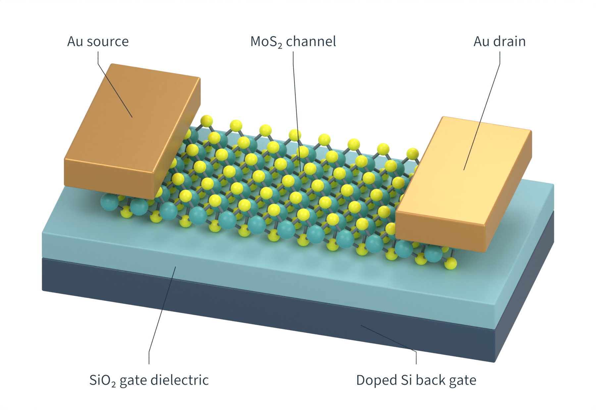
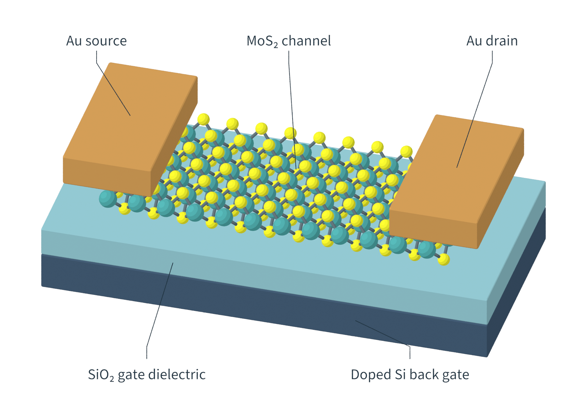

# Materials Schematic

Use `atomistic-model` to build or revise an atomic structure and deliver a validated extended XYZ. Use `materials-schematic` to build a new editable Blender figure and `materials-schematic-edit` for local changes to an approved blend. Blender on the cluster builds the scene and renders it headlessly. A desktop Blender installation can open the result directly.

| Studio | Cartoon |
| --- | --- |
| [](examples/mos2/studio.blend) | [](examples/mos2/cartoon.blend) |
| [Editable studio scene](examples/mos2/studio.blend) | [Editable cartoon scene](examples/mos2/cartoon.blend) |

Gold source and drain contacts overlap a monolayer channel. Teal marks Mo sites and yellow marks S sites. The oxide and doped silicon back gate are continuum solids. Contact dimensions and interface spacings are schematic. In the Blender Outliner, `atomistic` holds the channel, `continuum` the device solids, and `label` the text and leaders. The `effect` collection is available for depictions such as electron clouds. Both files include packed typography, camera, lights and editable material nodes.

## Shared defaults

| Scope | Where the default takes effect |
| --- | --- |
| Atomic geometry and colors | [ASE preparation](skills/materials-schematic/scripts/prepare.py) assigns Jmol colors, scales ASE covalent radii and builds connectivity using the selected bond rule. |
| Atom shading | [Atomic meshes](skills/materials-schematic/scripts/atoms.py) use the same element-material constructor for every species. The [shader builder](skills/materials-schematic/scripts/appearance.py) reads `cartoon.atom_bands` from the [presets](skills/materials-schematic/assets/presets.json). New cartoon atoms use 60% band strength and five tones. |
| Device materials and output | Device swatches and bond materials use their own presets. The scene builder and launcher apply the configured width and transparent-background defaults. |
| Figure composition | The [creation skill](skills/materials-schematic/SKILL.md) guides the agent's choice of viewpoint, contact layout and labels for each figure. |

## Install and invoke

From the repository root on x86-64 Linux or WSL2, run:

```bash
./build.sh
```

The script prepares `.figure-env` from the conda-forge lock and checks that the existing Blender executable starts. It reuses a matching environment. For a fresh environment it uses conda or mamba on PATH, or downloads and verifies a pinned Miniforge installer. First-time package downloads need network access. The Python tools can then run directly with `.figure-env/bin/python`. On a cluster, load Blender on PATH or set `BLENDER_EXE` to its executable. WSL can also use an existing Windows Blender installation.

For atomic modeling with ASE and pymatgen, run `./build.sh --modeling`. This creates the independent `.model-env` from its conda-forge lock and works on hosts without Blender. Use `.model-env/bin/python` for a modeling recipe or either database import. Example request: “Use $atomistic-model to start from C2DB entry 1MoS2-1, make a 4 × 4 monolayer, remove one top-layer S, and deliver the unrelaxed extxyz.” The geometry and its source history travel together into the figure. [Modeling skill](skills/atomistic-model/SKILL.md) · [Sources and commands](skills/atomistic-model/references/sources.md)

Codex can follow the local skills from this checkout. To use them across projects, link each folder once:

```bash
mkdir -p ~/.agents/skills
ln -sT "$PWD/skills/atomistic-model" ~/.agents/skills/atomistic-model
ln -sT "$PWD/skills/materials-schematic" ~/.agents/skills/materials-schematic
ln -sT "$PWD/skills/materials-schematic-edit" ~/.agents/skills/materials-schematic-edit
```

For a new figure, attach a sketch and a CIF and ask “Use $materials-schematic to match the contact placement in my sketch, use the CIF for the channel, and deliver a studio .blend.” To revise a saved figure, ask “Use $materials-schematic-edit on my approved blend. Color just the sulfur atoms violet and show the drain at 35% opacity.” [Editing API](skills/materials-schematic/references/editing.md)

## Reproduce the device

Run from the repository root after `./build.sh`. The versioned MoS₂ example is in `examples/mos2/`. Reproduction runs and visual experiments use the Git-ignored `test/` workspace. Reusable checks live in `validation/`. The default destination for user figures is `figure-output/`, also ignored.

```bash
SKILL="$PWD/skills/materials-schematic"
PY="$PWD/.figure-env/bin/python"
d=examples/mos2
out=test/reproduction
mkdir -p "$out"
"$PY" "$SKILL/scripts/prepare.py" "$d/channel.extxyz" "$out/channel.npz" --bonds mos2
"$PY" "$SKILL/scripts/host.py" --geometry "$out/channel.npz" --script "$d/compose.py" \
  --output "$out/studio.blend" --render "$out/studio.png"
"$PY" "$SKILL/scripts/host.py" --input "$out/studio.blend" --style cartoon \
  --output "$out/cartoon.blend" --render "$out/cartoon.png"
"$PY" "$SKILL/scripts/host.py" --input "$out/cartoon.blend" --script "$d/revise.py" \
  --output "$out/revised.blend" --render "$out/revised.png"
```

New studio and cartoon figures default to a width of 4500 px, about 602 ppi at a printed width of 190 mm. The MoS₂ composition renders at 4500 × 3100 with its original aspect ratio. The shipped 1800 × 1240 files retain their benchmark dimensions. PNG exports default to a transparent background. Add `--no-transparent` for the white backgrounds in the shipped examples. [Output presets](skills/materials-schematic/assets/presets.json)

The last command changes the gate label to n⁺ Si in the existing scene. For a quick proof, add `--preview`. Open the blend in a graphical session for interactive editing. A saved blend also supports direct cluster rendering, for example `blender -b "$out/studio.blend" -t 4 -o //studio- -F PNG -f 1`. In a Slurm allocation, the skill launcher honors `SLURM_CPUS_PER_TASK`. Choose a partition and allocation according to the cluster's configuration. [Blender background rendering](https://docs.blender.org/manual/en/latest/advanced/command_line/render.html)

## Verify a local revision

After the reproduction steps above, apply the validation patch. It labels exposed Mo and S sites and shows the lattice underneath the drain with a transparent contact. Both styles use the baseline camera and scientific structure. [Validation patch](validation/refine_mos2.py)

```bash
"$PY" "$SKILL/scripts/host.py" --input "$out/studio.blend" --script validation/refine_mos2.py \
  --output "$out/refined/studio.blend" --render "$out/refined/studio.png" --transparent
"$PY" "$SKILL/scripts/host.py" --input "$out/refined/studio.blend" --style cartoon \
  --output "$out/refined/cartoon.blend" --render "$out/refined/cartoon.png"
```

Creation and local revision have different inputs and checks. Both skills use the same launcher, material presets and ASE converter. This division follows the one-job guidance and OpenAI's example of separate PR-review and CI-repair skills sharing the GitHub CLI. The scoped material API also borrows the idea of specifying a target and representation from ChimeraX. [Codex skills guide](https://developers.openai.com/codex/skills/) · [PR review skill](https://github.com/openai/skills/tree/main/skills/.curated/gh-address-comments) · [CI repair skill](https://github.com/openai/skills/tree/main/skills/.curated/gh-fix-ci) · [ChimeraX transparency command](https://github.com/RBVI/ChimeraX/blob/develop/src/bundles/std_commands/src/transparency.py)

## Supporting-tools container

The optional Linux amd64 image uses the same explicit environment lock. Mount a working directory for structure conversion, then pass the resulting NPZ to the cluster or desktop Blender.

```bash
docker build --platform linux/amd64 -t materials-schematic skills/materials-schematic
mkdir -p test/container
docker run --rm --network none --user "$(id -u):$(id -g)" \
  -v "$PWD:/work" materials-schematic python /opt/materials/scripts/prepare.py \
  examples/mos2/channel.extxyz test/container/channel.npz --bonds mos2
```

## Implementation and evidence

The upstream figure-design workflow informs the sketch intake, composition and rendered review. The skill reuses upstream camera, color-conversion and Cycles device helpers. Its atomistic layer uses ASE neighbor lists and a Blender mesh of sites and bonds. Geometry Nodes instance one prototype per species and a unit cylinder for bonds. This keeps geometry editable and moves with individual site edits. Beautiful Atoms already provides rich Blender-native chemistry tools. Keeping ASE in the support environment lets these scenes travel to stock Blender installations without an extension or a second package environment inside Blender. [Upstream implementation](https://github.com/lgwrightlab/schematic-figure/tree/09d8b6e98d04b91de6e8b6632b3356b9fc237417/.claude/skills/schematic-figure/foundation/blender) · [Beautiful Atoms](https://github.com/beautiful-atoms/beautiful-atoms) · [ASE neighbor lists](https://docs.ase-lib.org/ase/neighborlist.html)

See the [skill workflow](skills/materials-schematic/references/workflow.md) for the API and edit controls, the [validation report](validation/RESULTS.md) for timings, scientific checks and limitations, and the [attribution](skills/materials-schematic/ATTRIBUTION.md) for code, data and font licenses.
